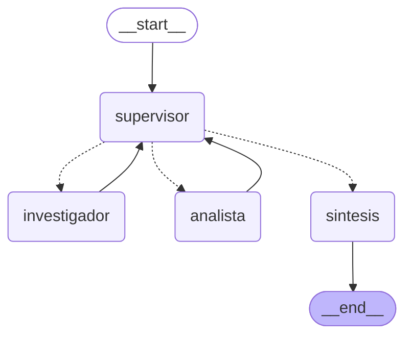

# Entregable 6 · Orquestador multi-agente especializado

Módulo 6 — *Sistemas multi-agente*.

Un **Supervisor** (LLM con salida estructurada) recibe una consulta, la reparte
entre dos especialistas con herramientas acotadas, valida lo que devuelven con
una rúbrica y recién entonces pasa a un nodo de **síntesis** que redacta la
respuesta. Todo sobre un `StateGraph` de LangGraph.

```python
from graph import crear_app
from state import estado_inicial

app = crear_app()                       # LLM del .env
final = app.invoke(estado_inicial("¿Cuántos días de vacaciones acumula quien cumple 12 años?"))
print(final["messages"][-1].content)    # respuesta de síntesis
print(final["contribuciones"])          # quién aportó qué, en qué paso
```

---

## 1. Cómo levantar el entorno

```bash
cd entregable6
uv venv --python 3.12
uv pip install -r requirements.txt

cp .env.example .env         # completá la API key de UN proveedor (gemini / openai / anthropic)

python verificar.py          # criterios de aceptación (offline, sin API key)
python main.py               # demo real: 2 escenarios + evidencia/ (requiere LLM)
python main.py --proveedor openai
```

Sin `uv`: `python -m venv .venv` y `.venv/Scripts/pip install -r requirements.txt`.
Requiere **Python 3.12**. Las claves viven solo en `.env` (ignorado por git).

| Variable | Default | Para qué sirve |
|---|---|---|
| `LLM_PROVIDER` | `gemini` | `gemini`, `openai` (o compatible, ej. Groq) o `anthropic` |
| `ORQ_MAX_PASOS` | `8` | Tope duro de invocaciones a especialistas |
| `ORQ_MAX_REFINAMIENTOS` | `1` | Reintentos permitidos a un mismo especialista |

## 2. Estructura

```
entregable6/
├── state.py            # AgentState(MessagesState) + Contribucion + estado_inicial()
├── agents/
│   ├── research_agent.py   # Investigador (busca, no calcula)
│   ├── analyst_agent.py    # Analista (calcula, no busca)
│   ├── herramientas.py     # buscar_en_politicas · calculadora · estadisticas
│   └── _base.py            # nodo ReAct con contexto acotado + registro de contribución
├── supervisor.py       # Supervisor: decisión estructurada, rúbrica y guardas
├── graph.py            # StateGraph, arista condicional con Literal, síntesis
├── main.py             # demo real (escribe evidencia/)
├── verificar.py        # 26 chequeos offline con dobles deterministas
└── evidencia/grafo.mmd # diagrama Mermaid exportado desde el grafo compilado
```

## 3. Diagrama del grafo

Generado con `app.get_graph().draw_mermaid()` (las líneas punteadas son aristas condicionales):



## 4. Por qué esta topología

**Jerárquica tipo hub-and-spoke.** Los especialistas nunca se hablan entre sí:
cada uno termina y vuelve al Supervisor, que es el único que decide el flujo y
el único lugar donde se valida.

- **Por qué no una cadena fija** (`investigador → analista → fin`): una pregunta
  que solo necesita búsqueda no debería gastar al analista, y un cálculo
  incorrecto debe poder reenviarse. El ruteo lo decide el LLM en cada vuelta.
- **Por qué no una red libre** (agentes que se llaman entre sí): el flujo sería
  imposible de acotar y de auditar. Con un hub hay un solo punto de control.
- **Fase de síntesis separada**: el Supervisor decide *cuándo* terminar; otro
  nodo redacta *qué* se responde. Así la respuesta final usa solo los aportes
  validados.

### Estado compartido (`state.py`)

`AgentState` hereda `MessagesState` y suma `next_agent`, `instruccion`, `razon`,
`pasos`, `task_completed`, `motivo_fin` y sobre todo **`contribuciones`**: lista
de `{agente, paso, instruccion, aporte}` con reducer `operator.add`. Cada nodo
devuelve solo su aporte y LangGraph lo concatena; ninguno pisa el trabajo del
otro y siempre se sabe quién dijo qué.

### Validación (rúbrica en el Supervisor)

El prompt del Supervisor incluye una rúbrica explícita antes de permitir `FINISH`:
**R1** datos con fuente · **R2** cálculo con la cuenta a la vista · **R3** los
números del analista coinciden con los del investigador · **R4** responde lo
preguntado. Si alguna falla, devuelve la tarea al responsable con una
instrucción de refinamiento.

## 5. Manejo de conflictos y errores comunes

| Riesgo | Cómo se maneja |
|---|---|
| **Supervisor infinito** | Tres capas, las dos primeras en **código** (el LLM no puede saltearlas): `MAX_PASOS` corta todo; `MAX_REFINAMIENTOS` limita reintentos por agente (motivo `sin_progreso`); y la rúbrica da un criterio de suficiencia. Si se corta por límite, la síntesis lo avisa en vez de aparentar certeza. |
| **Contaminación de contexto** | El especialista **no ve el historial**: recibe solo la `instruccion` del Supervisor, que debe ser autocontenida (con los números que necesita). |
| **Conflicto entre agentes** (el analista usa un dato distinto al del investigador) | La regla R3 lo detecta en el Supervisor, que reenvía al analista con el valor correcto citado de `contribuciones`. Los agentes no negocian entre sí. |
| **Cerrar sin haber trabajado** | Guarda en código: un `FINISH` sin contribuciones se convierte en `investigador`. |
| **Ejecución de código por el LLM** | La calculadora parsea el AST y solo admite aritmética (nada de `eval()`); rechaza exponentes enormes. |
| **Herramientas con alcance mínimo** | Investigador: solo `buscar_en_politicas`. Analista: solo `calculadora` y `estadisticas`. |

La "fuente externa" del Investigador es una búsqueda simulada sobre las
políticas internas de TechCorp (mismo corpus que las pre-entregas 3/4), que la
consigna admite y permite correr sin Pinecone ni red.

## 6. Verificación

`python verificar.py` corre offline (sin API key) con dobles deterministas
inyectados en `construir_grafo` y valida: campos del estado, reducer, topología
(especialistas siempre vuelven al Supervisor, no se hablan entre sí), flujo
investigador → analista → síntesis, refinamiento, los topes anti bucle y las
herramientas (incluida la calculadora frente a código malicioso).

## 7. Evidencia de ejecución real

`python main.py --proveedor openai` (Groq, `openai/gpt-oss-20b`) dejó en `evidencia/`:
`ejecucion.log` (legible), `traza_ejecucion.json` y `grafo.mmd`.

- **Escenario 1** (datos + cálculo): `investigador -> analista -> síntesis`, total **231 días**.
- **Escenario 2** (solo búsqueda): solo `investigador`; el Supervisor no llama al analista.

**Hallazgo durante la prueba real:** en una primera corrida el Supervisor dijo `FINISH`
con la razón "el analista aportará el cálculo" sin haberlo invocado, y la síntesis hizo
la cuenta por su cuenta (se saltó la rúbrica R2). Se corrigió con una guarda en código:
el Supervisor declara `requiere_calculo` y un `FINISH` sin contribución del analista se
convierte en `analista`; además la síntesis tiene prohibido calcular. Hay un chequeo
en `verificar.py` que cubre este caso.
