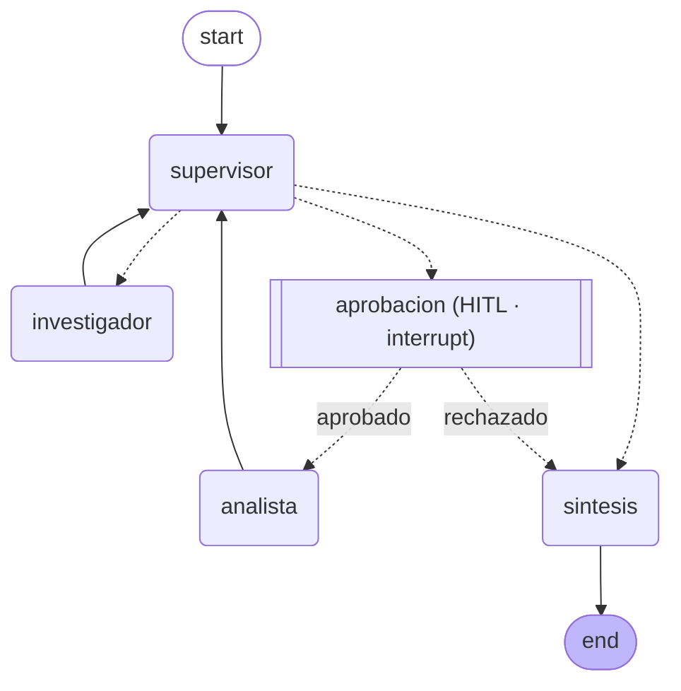

# Entregable 7 · API de producción y monitoreo activo

Módulo 7 — *API de producción*.

Expone el **orquestador multi-agente del Módulo 6** (Supervisor + Investigador +
Analista + Síntesis) detrás de una **API REST FastAPI asíncrona**, con cuatro
capacidades nuevas de producción:

| Capacidad | Dónde vive |
|---|---|
| **Endpoints asíncronos** (encola y devuelve `job_id`, no bloquea el event loop) | `app/main.py` + `app/worker.py` |
| **Estado en Redis** (jobs + *checkpoints* de LangGraph con `RedisSaver`) | `app/jobs.py` + `app/redis_checkpoint.py` |
| **Observabilidad activa** (trazas por nodo a Arize Phoenix vía OpenInference) | `app/observability.py` |
| **Human-in-the-loop** (pausa obligatoria para aprobar la acción crítica) | `app/hitl.py` + `app/graph.py` |

---

## 1. Endpoints

| Método | Ruta | Qué hace |
|---|---|---|
| `POST` | `/tasks` | Encola la consulta y **devuelve `job_id` de inmediato** (HTTP 202). No bloquea. |
| `GET` | `/tasks/{job_id}` | Estado del job (solo lee Redis): `PENDING · RUNNING · AWAITING_APPROVAL · DONE · FAILED`. |
| `POST` | `/tasks/{job_id}/approve` | Resuelve la pausa HITL: `{"aprobado": true}` reanuda, `{"aprobado": false}` cierra sin calcular. |
| `GET` | `/health` | Salud + estado de Redis + backend de observabilidad. |
| `GET` | `/docs` | Swagger UI (interactivo). |

**Por qué no bloquea el event loop:** los endpoints solo tocan Redis (operación
rápida) y delegan el trabajo pesado —invocar el grafo y el LLM— a
`BackgroundTasks`, que FastAPI corre en un *threadpool*. El event loop nunca
espera a un LLM (ver "Errores comunes a evitar" de la consigna).

### Ciclo de vida de un job

```
POST /tasks ─► PENDING ─► RUNNING ─┬─► DONE
                                   ├─► FAILED               (excepción capturada)
                                   └─► AWAITING_APPROVAL ─► (POST /approve) ─► RUNNING ─► DONE
```

## 2. El grafo multi-agente + gate HITL



La topología *hub-and-spoke* del M6 se mantiene intacta. La **única diferencia**
es el nodo `aprobacion`: el Supervisor ya no manda al analista directamente, sino
que pasa por el gate HITL.

**¿Cuál es la acción "crítica"?** La ejecución del **analista**: es el único
especialista que corre una herramienta de cálculo (en un sistema real, con costo
de tokens por cada llamada). Antes de dejarlo correr, el grafo se detiene con
`interrupt()` de LangGraph y espera aprobación humana. La aprobación se registra
en el estado (`aprobacion_analista`), así un refinamiento posterior del analista
no vuelve a pausar (se aprueba una sola vez por tarea).

## 3. Cómo levantar todo

### Opción A — Docker Compose (recomendada, todo en un comando)

```bash
cd entregable7
cp .env.example .env          # completá la API key de UN proveedor
docker compose up --build
```

Levanta tres servicios: **Redis Stack** (`:6379`, con RediSearch que necesita el
`RedisSaver`), **Arize Phoenix** (`:6006`) y la **API** (`:8000`).

### Opción B — Local (venv) + Redis y Phoenix en contenedores

```bash
cd entregable7
uv venv --python 3.12
uv pip install -r requirements.txt
cp .env.example .env          # completá la API key de UN proveedor

# Redis STACK (no el redis común: hace falta RediSearch) y Phoenix:
docker run -d --name e7-redis   -p 6379:6379 redis/redis-stack:7.4.0-v0
docker run -d --name e7-phoenix -p 6006:6006 arizephoenix/phoenix:version-7.9.0

uvicorn app.main:app --reload --port 8000
```

Sin `uv`: `python -m venv .venv` y `.venv/Scripts/pip install -r requirements.txt`.
Requiere **Python 3.12**. Las claves viven solo en `.env` (ignorado por git).

| Variable | Default | Para qué sirve |
|---|---|---|
| `LLM_PROVIDER` | `gemini` | `gemini`, `openai` (o compatible, ej. Groq) o `anthropic` |
| `REDIS_URL` | `redis://localhost:6379/0` | Redis **Stack** (jobs + checkpoints) |
| `OBSERVABILITY` | `phoenix` | `phoenix`, `langsmith` o `none` |
| `PHOENIX_COLLECTOR_ENDPOINT` | `http://localhost:6006` | Colector OTLP de Phoenix |
| `LLM_MAX_RETRIES` | `6` | Reintentos con backoff ante 429 del proveedor |
| `ORQ_MAX_PASOS` | `8` | Tope duro anti "supervisor infinito" |

## 4. Probar la API

### Flujo completo con `curl`

```bash
# 1) Encolar una tarea que requiere cálculo (disparará el HITL)
curl -X POST localhost:8000/tasks -H "Content-Type: application/json" \
  -d '{"pregunta":"Un empleado con 12 años de antigüedad: confirmá los días de vacaciones por tramo y calculá el total."}'
# -> {"job_id":"abc123...","estado":"PENDING"}

# 2) Consultar estado (polling). En algún momento devuelve AWAITING_APPROVAL
curl localhost:8000/tasks/abc123
# -> {"estado":"AWAITING_APPROVAL","aprobacion":{"tipo":"aprobacion_requerida","motivo":"..."}}

# 3) Aprobar la acción crítica -> el grafo reanuda y termina
curl -X POST localhost:8000/tasks/abc123/approve -H "Content-Type: application/json" \
  -d '{"aprobado":true}'

# 4) Consultar hasta DONE
curl localhost:8000/tasks/abc123
# -> {"estado":"DONE","resultado":{"respuesta_final":"... 231 días ...","agentes_en_orden":["investigador","analista"]}}
```

### Las 5 peticiones concurrentes (prueba de carga)

```bash
python prueba_carga.py --n 5        # lanza 5 en paralelo y auto-aprueba las pausas HITL
python prueba_carga.py --n 5 --no-approve   # las deja pausadas a propósito
```

Mientras corre, abrí **Phoenix en http://localhost:6006** y sacá las capturas
(trazas por nodo, costo por ejecución y latencia p95). Van en `screenshots/`
(ver `screenshots/README.md` para la lista exacta).

> **Nota sobre los tiers gratuitos.** 5 ejecuciones multi-agente concurrentes
> hacen muchas llamadas al LLM y **superan el límite de requests/minuto de los
> tiers gratuitos** (Groq: 8000 tokens/min; Gemini free: 5 req/min y 20 req/día).
> El `LLM_MAX_RETRIES` con backoff absorbe parte de esos 429; lo que no entra se
> marca `FAILED` (ver §6). Para una corrida con las 5 en `DONE`, usá una API key
> de tier pago o bajá la concurrencia. Las trazas se registran en Phoenix igual,
> tanto para los jobs `DONE` como para los `FAILED`.

## 5. Observabilidad

`app/observability.py` inicializa el backend según `OBSERVABILITY`:

- **`phoenix`** (default): `phoenix.otel.register(...)` + `LangChainInstrumentor`
  de OpenInference. Instrumenta **automáticamente** toda llamada de LangChain /
  LangGraph, así cada nodo del grafo (supervisor, investigador, analista,
  síntesis) y cada llamada al LLM aparecen como *spans* con sus tokens y
  latencia. Phoenix calcula el **costo por ejecución** a partir de los tokens.
- **`langsmith`**: no instrumenta nada; LangChain emite las trazas con las
  variables `LANGSMITH_API_KEY` / `LANGCHAIN_TRACING_V2`.
- **`none`**: desactiva la observabilidad (tests/CI).

> El costo en USD depende de que la plataforma conozca el precio del modelo. Con
> un modelo de OpenAI/Anthropic lo calcula sola; con uno de Groq puede mostrar
> solo tokens (ver `screenshots/README.md`).

## 6. Manejo de errores (job → FAILED)

El worker envuelve **toda** la ejecución en `try/except` (`app/worker.py`):
cualquier excepción del agente en segundo plano (incluido un 429 que agotó los
reintentos) se captura y el job pasa a `FAILED` en Redis con el mensaje de error.
Así el cliente que hace *polling* nunca queda en un loop infinito esperando un
job que murió en silencio (error común señalado en la consigna).

## 7. Verificación determinista (mejora sugerida)

> *"Incluí la salida de `python verificar.py` (los chequeos deterministas) junto a
> la evidencia, para que la validación sea verificable por cualquiera que clone el
> repositorio."*

`verificar.py` corre **100% offline**: sin red, sin servidor Redis y sin API
keys. Reemplaza el LLM y Redis por dobles deterministas (un `MemorySaver` para el
grafo y un Redis en memoria para el `JobStore`) y valida **44 chequeos** sobre lo
que NO depende del modelo:

```bash
python verificar.py
```

Cubre: estructura del estado (con el campo HITL), topología del grafo (el gate
`aprobacion` entre supervisor y analista), el **flujo HITL completo** (pausa con
`interrupt`, reanudar aprobando → corre el analista, reanudar rechazando → cierra
sin calcular, y "se aprueba una sola vez"), las guardas anti "supervisor
infinito" del M6, la **máquina de estados del JobStore** sobre Redis, el **worker
que marca FAILED ante una excepción**, y la seguridad de la calculadora.

La salida completa está guardada en **`evidencia/verificar_salida.txt`** (los 44
chequeos en `OK`). Cualquiera que clone el repo puede reproducirla con el comando
de arriba.

## 8. Estructura

```
entregable7/
├── app/
│   ├── main.py             # FastAPI: POST /tasks, GET /tasks/{id}, POST /approve, /health
│   ├── graph.py            # grafo del M6 + gate HITL + compile con checkpointer
│   ├── worker.py           # corre el grafo en background y actualiza Redis (incl. FAILED)
│   ├── observability.py    # init de Phoenix / LangSmith (OpenInference)
│   ├── hitl.py             # nodo de aprobación humana (interrupt + ruteo)
│   ├── jobs.py             # JobStore sobre Redis (máquina de estados del job)
│   ├── redis_checkpoint.py # fábrica del RedisSaver (checkpoints de LangGraph)
│   ├── schemas.py          # modelos Pydantic de la API
│   ├── config.py           # entorno, fábrica de LLM, Redis, observabilidad
│   ├── state.py            # AgentState (M6) + campo aprobacion_analista (HITL)
│   ├── supervisor.py       # Supervisor del M6 (decisión estructurada + guardas)
│   └── agents/             # investigador, analista, herramientas (M6)
├── prueba_carga.py         # 5 peticiones concurrentes + auto-aprobación HITL
├── verificar.py            # 44 chequeos deterministas (offline)
├── requirements.txt
├── Dockerfile
├── docker-compose.yml      # app + redis-stack + phoenix
├── .env.example
├── evidencia/              # salida de verificar.py + de la prueba de carga
└── screenshots/            # capturas del dashboard (observabilidad)
```

## 9. Checklist de la rúbrica

- [x] Endpoint asíncrono que encola y devuelve `job_id` sin bloquear el event loop → `POST /tasks` + `BackgroundTasks`.
- [x] Estado del job en Redis, incluido el paso a `FAILED` ante excepción → `app/jobs.py` + `app/worker.py`.
- [x] Checkpoints de LangGraph en Redis (`RedisSaver`) → `app/redis_checkpoint.py`.
- [x] Trazas por nodo en el dashboard (Phoenix) → `app/observability.py` + `screenshots/`.
- [x] Costo por ejecución y latencia p95 de las 5 concurrentes → `prueba_carga.py` + `screenshots/`.
- [x] Nodo Human-in-the-loop que pausa hasta aprobación externa → `app/hitl.py` + `POST /approve`.
- [x] README con pasos para Redis + API + las 5 concurrentes, y `requirements.txt`.
- [x] **Mejora:** salida de `verificar.py` incluida en `evidencia/`.
```
