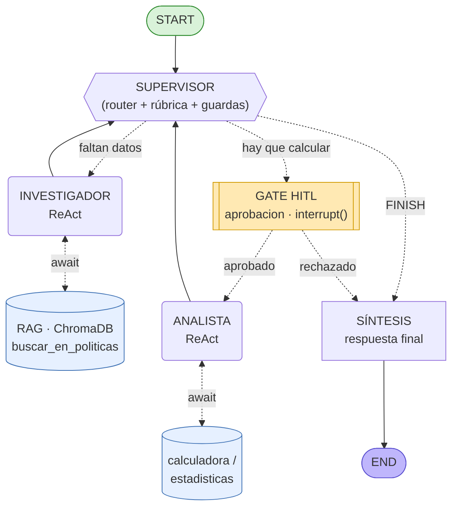

# The Intelligence System — Proyecto Final (AI Engineering)

> **En 5 minutos, para un ingeniero senior:** este es un sistema multi-agente de
> grado de producción. Un **Supervisor** orquesta a dos especialistas —un
> **Investigador** que consulta una base de conocimiento por **RAG** y un
> **Analista** que calcula— detrás de una **API FastAPI asíncrona**. El estado de
> cada conversación se **persiste en Redis** (checkpointer de LangGraph), toda
> acción crítica pasa por un **gate Human-in-the-loop**, y cada ejecución deja un
> **árbol de trazas con su costo en USD** en Arize Phoenix. Levanta con **un solo
> comando**.

Este repositorio **ensambla y refactoriza** las pre-entregas del curso en un único
proyecto unificado (se entiende sin conocer el historial de los módulos):

| Capa | Origen | Dónde vive |
|---|---|---|
| Cliente LLM async + fábrica de modelos multiproveedor | M1 / M2 | `app/config.py` |
| **RAG** (ingesta, embeddings, recuperación) | **M3 / M4** | `app/rag/` + `data/` |
| Orquestador multi-agente (Supervisor + especialistas) | M5 / M6 | `app/graph.py`, `app/supervisor.py`, `app/agents/` |
| API, Redis, observabilidad, HITL | M7 | `app/main.py`, `app/jobs.py`, `app/observability.py`, `app/hitl.py` |

---

## Las cuatro capacidades (lo que pide la consigna)

1. **Conocimiento específico vía RAG.** El investigador no "sabe" las políticas de
   la empresa: las **recupera** de un índice vectorial (ChromaDB) con su herramienta
   `buscar_en_politicas`. El RAG del M3/M4 **es** la tool del investigador.
2. **Razonamiento multi-paso.** El Supervisor decide, delega, valida con una rúbrica
   y corrige; los especialistas razonan en ciclos ReAct. No es una cadena lineal.
3. **Interfaz profesional.** Una API REST documentada (OpenAPI/Swagger en `/docs`),
   no un script de consola. Entradas y salidas validadas con Pydantic.
4. **Trazabilidad completa.** Cada nodo del grafo y cada llamada al LLM aparecen como
   *spans* en Phoenix, con tokens, latencia y **costo en USD** por ejecución.

---

## Diagrama del grafo de agentes



**Topología *hub-and-spoke*:** los especialistas nunca se hablan entre sí; siempre
vuelven al Supervisor, que es el único que decide el próximo paso. La acción
**crítica** (ejecutar el Analista, que consume cómputo/tokens) está protegida por el
**gate HITL**: el grafo se detiene con `interrupt()` y espera aprobación externa.

### Ciclo de vida de una tarea (API)

```
POST /tasks ─► PENDING ─► RUNNING ─┬─► DONE
                                   ├─► FAILED               (excepción capturada)
                                   └─► AWAITING_APPROVAL ─► POST /approve ─► RUNNING ─► DONE
```

---

## Cómo levantarlo

### Opción A — Docker Compose (recomendada · una sola instrucción)

```bash
cp .env.example .env     # completá la API key de UN proveedor (gemini/openai/anthropic)
docker compose up --build
```

Levanta tres servicios: **Redis Stack** (`:6379`, con RediSearch que necesita el
`RedisSaver`), **Arize Phoenix** (`:6006`) y la **API** (`:8000`). El índice RAG y el
modelo de embeddings quedan **horneados en la imagen** durante el build (ver
`Dockerfile`), así el contenedor arranca y consulta el RAG 100% offline.

### Opción B — Script `run.sh` (local)

```bash
./run.sh
```

Crea el entorno (Python 3.12), instala dependencias, levanta Redis+Phoenix en
contenedores, hace la **ingesta** del RAG y arranca la API. Idempotente.

> Requiere **Python 3.12+**. Las claves viven solo en `.env` (ignorado por git);
> no hay ninguna API key ni ID de índice escrito en el código.

---

## Probar el sistema

```bash
# 1) Encolar una tarea que requiere cálculo (dispara el HITL)
curl -X POST localhost:8000/tasks -H "Content-Type: application/json" \
  -d '{"pregunta":"Un empleado con 12 años de antigüedad: confirmá en la política los días de vacaciones por tramo y calculá el total acumulado."}'
# -> {"job_id":"abc123...","estado":"PENDING"}

# 2) Polling del estado. En algún momento: AWAITING_APPROVAL
curl localhost:8000/tasks/abc123

# 3) Aprobar la acción crítica -> el grafo reanuda y termina
curl -X POST localhost:8000/tasks/abc123/approve -H "Content-Type: application/json" \
  -d '{"aprobado":true}'

# 4) Consultar hasta DONE (incluye el costo en USD)
curl localhost:8000/tasks/abc123
```

### Las 5 pruebas concurrentes (observabilidad)

```bash
python prueba_carga.py --n 5              # 5 en paralelo, auto-aprueba las pausas HITL
```

Mientras corre, abrí **Phoenix en http://localhost:6006** y sacá las capturas
(trazas por nodo, costo por ejecución, latencia p95). Están en `screenshots/` y la
evidencia textual (tests, verificación, recuperación RAG real) en `evidencia/`. El
estado de la última corrida y cómo reproducir las trazas: `evidencia/nota_ejecucion.md`.

---

## Decisiones de arquitectura (para ingeniería senior)

### 1. Asincronía de punta a punta (sin bloquear el event loop)

- Los **endpoints** son `async`; solo tocan Redis (rápido) y devuelven de inmediato.
- El **worker** es una corrutina: `await app.ainvoke(...)`. La E/S con el **LLM** y el
  **RAG** se hace con `await` (SDKs asíncronos oficiales y `retriever.ainvoke`).
- Los especialistas corren como agentes ReAct con `ainvoke`; la **tool RAG es async**.
- Los pocos nodos aún síncronos (decisión del Supervisor, síntesis final) LangGraph
  los corre en su *executor*, de modo que **nada bloquea el event loop**. No hay un
  `requests` escondido dentro de un `async def` (el error #1 de la consigna).

### 2. Persistencia: Checkpointer de LangGraph en Redis

`RedisSaver` persiste el estado del grafo (incluida la pausa del HITL) con
`thread_id = job_id`. Una conversación pausada en un request puede **reanudarse en
otro** y **sobrevive a un reinicio** del servidor (`app/redis_checkpoint.py`).

### 3. Validación con Pydantic en cada frontera

- **API:** `app/schemas.py` valida request/response (`min_length`, tipos, etc. → 422).
- **Supervisor:** decide con **salida estructurada** (`DecisionSupervisor`), no texto
  libre (`app/supervisor.py`).
- **Guardas en código**, no solo en el prompt: `MAX_PASOS`, `MAX_REFINAMIENTOS` y una
  rúbrica de suficiencia acotan al LLM contra el "Supervisor Infinito".

### 4. RAG real como herramienta del agente (M3/M4 → M6)

`app/rag/` carga el corpus de `data/`, lo fragmenta **en tokens** (chunk 500 / overlap
70) y lo indexa en **ChromaDB** con embeddings locales
(`all-MiniLM-L6-v2`, offline, sin API key). El **mismo** modelo indexa y consulta
(una sola fuente de verdad). El investigador recupera con `top_k` acotado (3–5) y
**cita la fuente** de cada dato. Nada de rutas ni nombres de índice hard-codeados:
todo por variables de entorno.

### 5. Observabilidad y costo en USD

`app/observability.py` instrumenta LangChain/LangGraph vía OpenInference: cada nodo y
cada llamada al LLM son *spans* en Phoenix. Como algunos modelos (p. ej. Groq) no
traen tarifa, `app/costos.py` **calcula el costo en USD a partir de los tokens** (tabla
de precios editable + override por entorno) y lo acumula **a través de la pausa HITL**.

### 6. Manejo de errores (nunca una caja negra ni un polling infinito)

El worker envuelve toda la ejecución en `try/except`: cualquier excepción (incluido un
429 que agotó los reintentos con backoff) deja el job en **`FAILED`** en Redis, con el
mensaje. El cliente que hace polling siempre ve un estado terminal.

---

## Tests (offline) y verificación

Suite de **pytest** 100% offline (sin Redis, sin red, sin API keys), apoyada en los
mismos puntos de inyección que usa la app:

```bash
pip install -r requirements-dev.txt
pytest                 # suite completa
```

| Archivo | Qué cubre |
|---|---|
| `tests/test_api.py` | Endpoints vía `TestClient`: 202, flujo HITL por HTTP, 404/409/422, `/health`. |
| `tests/test_jobs.py` | Máquina de estados del `JobStore` + acumulación de costo. |
| `tests/test_worker.py` | Worker **async**: excepción→FAILED, interrupt→AWAITING, reanudar→DONE, costo. |
| `tests/test_hitl_graph.py` | Topología, gate `aprobacion`, pausa/aprobar/rechazar, "una sola aprobación", guardas. |
| `tests/test_rag.py` | **Capa RAG** con índice en memoria y embeddings falsos (offline). |
| `tests/test_costos.py` | Cálculo de costo en USD. |
| `tests/test_herramientas.py` | Seguridad de la calculadora (AST, sin `eval`). |

`verificar.py` replica los chequeos como **script autónomo** (sin instalar pytest),
útil como evidencia reproducible por cualquiera que clone el repo:

```bash
python verificar.py
```

---

## Estructura

```
proyecto-final/
├── app/
│   ├── main.py             # FastAPI: POST /tasks, GET /tasks/{id}, POST /approve, /health
│   ├── graph.py            # grafo del M6 + gate HITL + compile con checkpointer
│   ├── worker.py           # corre el grafo (async) y actualiza Redis (incl. FAILED)
│   ├── supervisor.py       # Supervisor: router + rúbrica + guardas (salida estructurada)
│   ├── hitl.py             # gate de aprobación humana (interrupt + ruteo)
│   ├── observability.py    # init de Phoenix / LangSmith (OpenInference)
│   ├── costos.py           # costo en USD por ejecución, calculado desde los tokens
│   ├── jobs.py             # JobStore sobre Redis (máquina de estados + costo)
│   ├── redis_checkpoint.py # fábrica del RedisSaver (checkpoints de LangGraph)
│   ├── schemas.py          # modelos Pydantic de la API
│   ├── config.py           # entorno + fábrica de LLM multiproveedor (async)
│   ├── state.py            # AgentState (M6) + campo aprobacion_analista (HITL)
│   ├── rag/                # ← base de conocimiento (M3/M4)
│   │   ├── vectorstore.py  #   embeddings locales + ChromaDB + búsqueda async
│   │   └── ingesta.py      #   ingesta de data/ al índice (chunking en tokens)
│   └── agents/             # investigador (tool RAG), analista (cálculo), base ReAct
├── data/                   # corpus: políticas internas de TechCorp (.txt)
├── tests/                  # suite pytest offline
├── prueba_carga.py         # 5 peticiones concurrentes + auto-aprobación HITL
├── verificar.py            # chequeos deterministas como script autónomo (offline)
├── Dockerfile              # imagen de la API (ingesta RAG en build)
├── docker-compose.yml      # api + redis-stack + phoenix  (docker compose up)
├── run.sh                  # arranque local con una instrucción
├── requirements.txt / requirements-dev.txt
├── .env.example            # plantilla de variables (sin secretos)
├── evidencia/              # salidas de pytest, verificar, costo USD y prueba de carga
└── screenshots/            # capturas de las trazas en Phoenix
```

---

## Checklist de la rúbrica

- [x] **Arquitectura y coherencia (30%).** RAG (M3/M4) + agentes con Supervisor (M5/M6)
      + API/Redis/observabilidad (M7) integrados en un flujo único y lógico.
- [x] **Robustez técnica (25%).** `async/await` de punta a punta (endpoints, worker,
      LLM, RAG) sobre Python 3.12 + validación con Pydantic y guardas en código.
- [x] **Persistencia y observabilidad (20%).** `RedisSaver` (checkpointer) + trazas por
      nodo y costo en USD en Phoenix, con evidencia de 5 pruebas.
- [x] **Documentación y despliegue (15%).** Este README con el diagrama del grafo y
      decisiones de arquitectura; `docker compose up` / `./run.sh` en un comando.
- [x] **Entorno y estándares (10%).** Python 3.12+, dependencias declaradas, variables
      de entorno (`.env.example`), sin secretos ni IDs hard-codeados.
```
